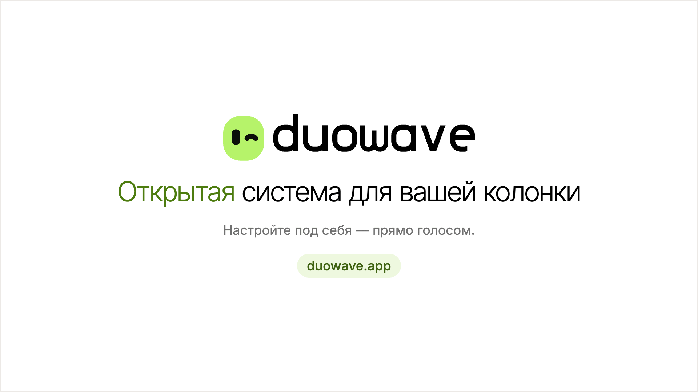
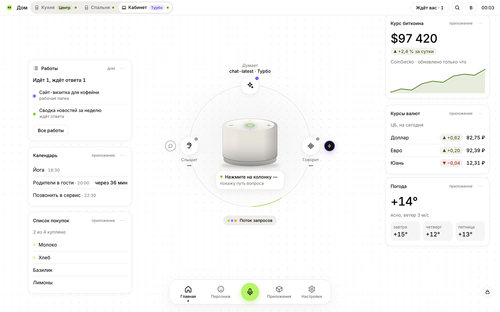
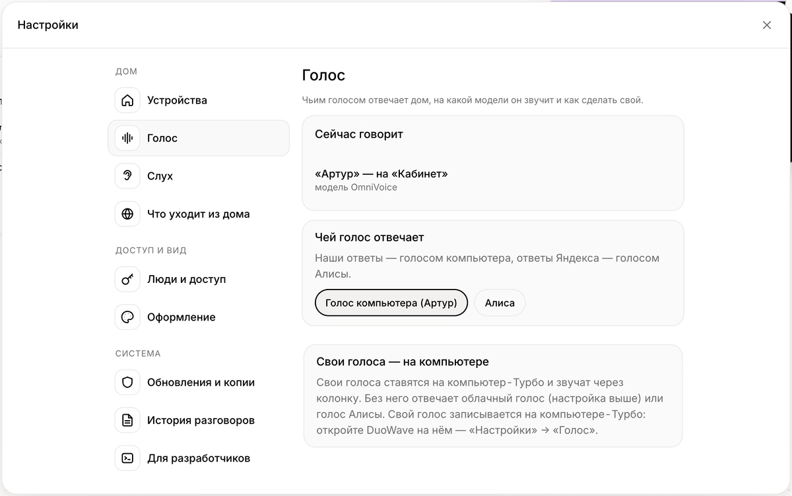
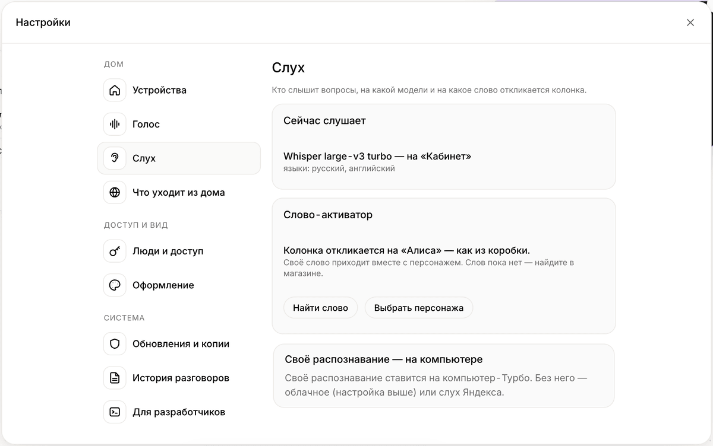
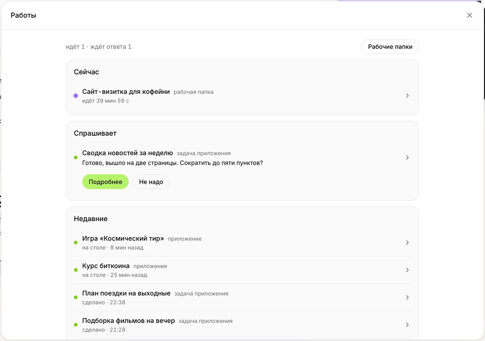
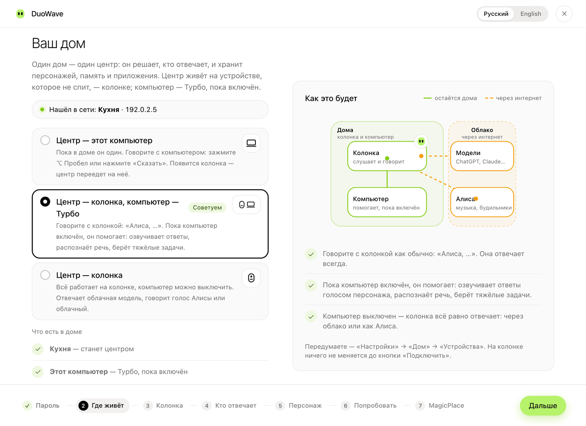

<p align="center">
  <a href="https://duowave.ai"><picture>
    <source media="(prefers-color-scheme: dark)" srcset="docs/media/desk-dark.gif">
    
  </picture></a>
</p>

<h1 align="center">DuoWave</h1>

<p align="center">
  DuoWave — бесплатный открытый голосовой помощник: одна маленькая программа между вашими вещами и любым ИИ. Скажите, что нужно, — он соберёт приложение, возьмёт на себя рутину и долгие задачи в фоне, а когда закончит — скажет.
</p>

<p align="center">
  DuoWave is a free, open-source AI assistant: one small program between your things and any AI. Say what you need — it builds small apps, automates your routine and takes on long tasks in the background, then tells you when they're done.
</p>

<p align="center">
  <a href="https://duowave.ai">duowave.ai</a> ·
  <a href="#поставить">Поставить</a> ·
  <a href="#первые-шаги">Первые шаги</a> ·
  <a href="docs/plugins/AUTHORING.md">Написать приложение</a> ·
  <a href="#чем-рискуете-и-как-вернуть">Как вернуть как было</a>
</p>

<p align="center">
  <a href="https://duowave.ai"><picture><source media="(prefers-color-scheme: dark)" srcset="docs/media/duowave-promo-poster-dark.png"></picture></a>
</p>

*A voice assistant for a rooted Yandex Station: any model, your own speech recognition and voice, apps you make by
voice — and you decide what leaves your home. DuoWave lives on the speaker itself; a computer with the app joins as
its «Turbo» for heavy work. Also runs alone on a computer or a home server: Docker, Linux, macOS, Windows. Open
source: Apache-2.0.*

> Проект не связан с Яндексом. Root на колонке — на риск её владельца. «Яндекс», «Алиса» и «Яндекс Станция» —
> товарные знаки их владельцев.

## Что это

Колонка с root говорит не только с облаком Яндекса, но и с DuoWave. На каждый вопрос DuoWave решает, кто слушает,
кто думает и кто говорит: своя модель — в облаке по своему ключу или дома, своё распознавание и свой голос, а чего
своё не умеет, подхватывает Алиса — музыка, сказки и умный дом работают как раньше.

- **Дом из устройств.** Колонка — центр дома: она всегда включена, хранит персонажей, память и приложения. Компьютер с
  приложением DuoWave — **Турбо**: пока он включён, распознаёт речь, озвучивает ответы своим голосом и берёт
  тяжёлые модели. Уснул — колонка не молчит, а отвечает облаком и Алисой. Нет колонки — центром станет сам компьютер.
- **Любая модель.** Claude, OpenAI, Gemini, DeepSeek, Mistral, Groq, YandexGPT — по своему ключу; OpenRouter или
  подписка ChatGPT — одним входом; дома — Ollama и LM Studio.
- **Вы решаете, кто отвечает и что уходит из дома.** «Алиса», «Алиса + ваш ИИ» или «Ваш ИИ» — одним выбором.
  Облачная модель получает текст вопроса, не звук.
- **Приложения голосом.** «Алиса, сделай игру» — мастерская сама напишет приложение, проверит его в песочнице и
  предложит поставить на стол. Готовые — в магазине MagicPlace.
- **Персонажи, голос и слух.** Характер, манера и голос одним выбором; свой голос по минуте записи; свои
  слова-активаторы.
- **Стол с виджетами.** Пульт — стол: колонка в центре, вокруг погода, таймеры, музыка, курсы, список покупок и то,
  что вы сделали голосом.

## Возможности

### Скажите — и оно на столе

<p align="center">
  <picture><source media="(prefers-color-scheme: dark)" srcset="docs/media/voice-widget-dark.gif"></picture>
</p>

«Алиса, сделай виджет с курсом биткоина» — и на столе сразу появляется плитка: видно, что агент мастерской сейчас
делает (пишет файлы, проверяет, пробует фразу). Готово — виджет «на примерке» с данными для примера: «Примерить» или
«На стол», кнопкой или голосом. Поставили — он стоит на столе с живыми данными и пометкой «новый». Так же делаются
игры («Алиса, сделай игру»), навыки и целые приложения. Код проверяется в песочнице, ставите его вы.

### Стол: колонка в центре, виджеты вокруг

<p align="center">
  <picture><source media="(prefers-color-scheme: dark)" srcset="docs/media/desk-home-dark.png"></picture>
</p>

Пульт — один на весь дом, откуда его ни открой: из приложения на компьютере, с телефона или из браузера. Вверху —
«Дом» и его устройства, в центре — колонка: видно, кто сейчас слышит, кто думает и кто говорит, и куда ушёл вопрос.
Вокруг — виджеты: погода, таймеры, что играет, радио, курсы, календарь, список покупок, «Работы». Их можно двигать и
прятать, у каждого человека в доме свой стол.

### Дом: центр, колонки и Турбо

- **Центр** — устройство, которое не спит: колонка (или домашний сервер). Он решает, кто отвечает, и хранит дом:
  персонажей, память, людей, приложения, ключи.
- **Турбо** — компьютер с приложением DuoWave. Он даёт дому мышцы: распознавание речи, свой голос, модели дома,
  приложения для компьютера. У Турбо — копия дома: вне дома он отвечает сам, тем же персонажем и с той же памятью, а
  изменения догоняют центр, когда компьютер вернётся.
- **Ещё колонки** — уши того же центра: у каждой своя комната, громкость и, если хотите, свой персонаж («в детской —
  один, на кухне — другой»), а память, люди и приложения — общие. «Сделать центром» переносит центр на другую
  колонку по домашней сети.

Всё это — в «Настройки» → «Дом» → «Устройства»: у каждого устройства своя страница — что оно даёт дому, на связи ли,
сколько ОЗУ и памяти, обновления.

### Кто отвечает и что уходит из дома

| «Кто отвечает» | Куда идёт голос | Кто отвечает |
|---|---|---|
| «Алиса» | к Яндексу, как без DuoWave | Алиса |
| «Алиса + ваш ИИ» | распознаёт своё или Яндекс — как выбрано | ваша модель, а чего она не умеет — Алиса |
| «Ваш ИИ» | распознавание и голос — свои | только своё; модель — облачная или дома |

Отдельно — «Что уходит из дома»: «Только дома», «Дом и моё облако» или «Любые облака». Облачная модель получает текст
вопроса, не звук. Звук запросов DuoWave на диск не пишет, пока это не включить для отладки. «Поток запросов» на столе
показывает путь каждого вопроса: кто услышал, кто думал, кто сказал.

### Мозг: любая модель

Провайдер — со своим ключом, входом через OpenRouter или подписку ChatGPT, или дома (Ollama, LM Studio на Турбо).
Быстрая модель — для коротких ответов, умная — для сложных; «Запасная» отвечает, когда основная недоступна. MCP-серверы
становятся инструментами модели. Персонаж помнит, что вы ему рассказали, — эту память видно в пульте.

### Персонажи, «Голос» и «Слух»

<p align="center">
  <picture><source media="(prefers-color-scheme: dark)" srcset="docs/media/settings-voice-dark.png"></picture>
  <picture><source media="(prefers-color-scheme: dark)" srcset="docs/media/settings-hearing-dark.png"></picture>
</p>

- **Персонаж** — характер, манера и голос колонки одним выбором: из каталога или свой, с полным текстом для тонкой
  настройки.
- **«Голос»** — кто говорит: голос Алисы, готовые голоса (Silero, Piper), облачные или свой — по минуте записи прямо в
  пульте (OmniVoice, CosyVoice 3, VoxCPM; модель скачивается на Турбо, нужна видеокарта или терпение). Записи голоса
  остаются у вас.
- **«Слух»** — чем слушаем: распознавание Яндекса, облачное (OpenAI, Groq) или своё дома, и слова-активаторы: колонка
  просыпается на своё слово, а не только на «Алиса».

Если голосу не хватает ОЗУ или он не встал, пульт скажет об этом с любого экрана и объяснит почему — числами.

### Приложения, мастерская и MagicPlace

<p align="center">
  <picture><source media="(prefers-color-scheme: dark)" srcset="docs/media/magicplace-dark.png"></picture>
</p>

- **Приложения** добавляют колонке фразы, виджеты на стол, окна, расписания, инструменты для модели, источники
  музыки и радио. Код работает в песочнице (QuickJS или WebAssembly) с лимитами памяти и времени и получает только те
  права, что вы дали. Приложение может работать на колонке или на Турбо — магазин заранее говорит где.
- **Мастерская** пишет их за вас: голосом через колонку («Алиса, сделай виджет с курсом биткоина»), в пульте с агентом
  или из [Claude Code](https://claude.com/claude-code) — через MCP-сервер мастерской и команду `duowave plugin`.
  Черновик проверяется в песочнице, ставите его вы.
- **MagicPlace** — магазин дома: приложения, персонажи, слова, темы пульта и агенты. «Рекомендуем» и «Новое»,
  обновления в одном месте; «Установить» открывает мастер — что поставится, сколько займёт, какие права попросит.
  Можно добавить и свои источники.

Как написать приложение руками — [docs/plugins/AUTHORING.md](docs/plugins/AUTHORING.md).

### «Работы»: долгие задачи в фоне

<p align="center">
  <picture><source media="(prefers-color-scheme: dark)" srcset="docs/media/works-dark.png"></picture>
</p>

Попросите голосом или кнопкой «Новая работа» — задача идёт в фоне, а DuoWave скажет, когда закончит или когда ему
нужен ваш ответ. Работа в рабочей папке на компьютере может вести агент-программа: её карточка — в MagicPlace.

### Подключения

- **Из коробки:** радио, погода, новости, утреннее шоу, сказки (и сочинённые на ходу), игры, умный дом, будильники и
  таймеры, своя музыка.
- **Подключения:** Home Assistant, MCP-серверы, Telegram (сообщения и звонки контактам — подключение всего дома),
  Claude Code. Свои скрипты и агенты — через ключ API.

## Чем рискуете и как вернуть

- **Что меняется на колонке:** файл прошивки `/system/vendor/quasar/quasar.cfg` — ничем. Поверх него при каждой
  загрузке подключается (bind-mount) наша копия, в которой другие только два адреса: голосовой сервер
  (`aliced.uniProxyUrl`) и QUIC рядом. Копия и всё остальное наше лежит в `/data/opt/duowave`. На разделе
  прошивки — один скрипт загрузки `/etc/init.d/S95duowave`: без `/data/opt/duowave` он ничего не делает.
- **Вернуть голос Яндексу** — четырьмя способами. DuoWave при этом остаётся на колонке, и пульт подключит её снова:
  1. пульт: «Кто отвечает» → «Алиса», или «Настройки» → «Дом» → «Устройства» → колонка → «Вернуть колонку Яндексу»;
  2. голосом, пока DuoWave жив: «Алиса, аварийный возврат к Яндексу» — он отвечает раньше любых правил и модели;
  3. без DuoWave: `ssh -p 2222 root@<колонка> sh /data/opt/duowave/restore.sh`;
  4. без ничего — одной командой (её же DuoWave отдаёт по адресу `/station/restore.sh`):
     `ssh -p 2222 root@<колонка> 'wget -qO- http://<центр>/station/restore.sh | sh'`.
- **Убрать DuoWave с колонки совсем**, будто его не ставили: `ssh -p 2222 root@<колонка> sh
  /data/opt/duowave/uninstall.sh`. Он возвращает голос Яндексу, останавливает DuoWave на колонке и клиент звонков,
  убирает их скрипты из `/etc/init.d`, удаляет `/data/opt/duowave` и перезагружает колонку; `--keep-data` оставляет
  данные на колонке. Без файла на колонке — `ssh -p 2222 root@<колонка> 'wget -qO- http://<центр>/station/uninstall.sh
  | sh'`. Пакет YAM скрипт не удаляет — дальше `yam remove duowave/gateway`.
- **Сброс кнопками** чистит `/data`, а с ним и нашу копию: после сброса это обычная Алиса.
- **Обновление от Яндекса** меняет файл прошивки: копия, снятая со старого файла, при загрузке не подключается, и
  колонка становится обычной Алисой (пульт скажет, что она обновилась; «Подключить» соберёт копию заново). Но
  обновление может закрыть root — отключите их по вики: DuoWave при подключении проверяет и предупреждает.
- **Центр на колонке — со страховкой:** если DuoWave на ней падает или перестаёт отвечать, колонка сама возвращается
  туда, куда шла раньше. Турбо уснул — колонка отвечает облаком и Алисой. Если центр — компьютер, а он выключен, колонка молчит:
  поэтому центр советуем держать на колонке, а компьютеру за колонкой — закрепить адрес в роутере (резервирование
  DHCP).

## Что нужно

- **Колонка с root и SSH** по вики сообщества [hackalice](https://hackalice.me/start/): root, SSH (Dropbear на порту
  2222) и отключённые обновления. DuoWave root не делает. Подходит почти любая Яндекс Станция; сами мы работаем на
  Станции Лайт 2. С другой моделью расскажите, как прошло, в issue «Новая модель колонки».
- **Компьютер — по желанию.** Чтобы поставить DuoWave на колонку, хватит любого компьютера в той же сети на пять
  минут: потом его можно выключить. Как Турбо или центр без колонки — Mac, Windows, Linux, NAS, Raspberry Pi 4/5 с
  64-битной системой. Самому DuoWave хватает до 200 МБ ОЗУ; своё распознавание и голос — ещё 2–4 ГБ, свой голос по
  записи — 3–8 ГБ.
- **Порт 7780** на компьютере: на нём пульт. Занят — подойдёт любой свободный: приложение предложит его само, в
  остальных случаях — строка `PORT` в `.env` (в Docker — `GATEWAY_PORT`). Пульт колонки — на её порту 8790.

## Поставить

### На колонку одной командой — компьютер потом не нужен

Колонка с root и SSH ([вики](https://hackalice.me/)), компьютер в той же сети Wi-Fi. В Терминале (macOS, Linux):

```sh
curl -fsSL https://github.com/duowaveai/duowave/releases/latest/download/install.sh | sh
```

В PowerShell (Windows 10 и новее):

```powershell
irm https://github.com/duowaveai/duowave/releases/latest/download/install.ps1 | iex
```

Команда скачает DuoWave для этого компьютера, сверит его с `SHA256SUMS` выпуска и спросит дальше в том же окне:
найдёт колонку, покажет, что на ней может помешать (другие моды — их можно выключить их же командой), и только после
вашего «да» поставит DuoWave на колонку, направит туда её голос и перезагрузит её. Не нашла колонку — скажет почему
(на macOS это часто запрет «Локальная сеть» для Терминала). В конце — адрес пульта колонки,
`http://<адрес колонки>:8790`, и код первой настройки: пульт спросит его вместе с паролем. На компьютере ничего не
остаётся. Адрес колонки можно назвать сразу: `… | sh -s -- 192.168.1.20`.

Код потерялся — он в журнале колонки:

```sh
ssh -p 2222 root@<колонка> 'grep -a "первая настройка пульта" /data/opt/duowave/gateway/gateway.log | tail -1'
```

### Приложение — macOS, Windows, Linux

Установщик — в [последнем выпуске](https://github.com/duowaveai/duowave/releases/latest): `.dmg` для Mac, `.exe` или
`.msi` для Windows, `.AppImage`, `.deb` или `.rpm` для Linux. DuoWave работает в трее, пульт — в своём окне, о новой
версии приложение скажет само. Первые шаги спросят, какой будет дом: колонка — центр, а компьютер — её Турбо
(советуем); только колонка; или только компьютер — тогда с ним говорят голосом через его микрофон. Установщики пока
без подписи Apple и Microsoft: система предупредит при первом запуске.

### На самой колонке — пакет YAM

На колонке с менеджером пакетов [YAM 0.2](https://hackalice.me/start/packages/) (пока Станция Лайт 2): файл
`duowave-gateway-<версия>-plum.yampkg` из [последнего выпуска](https://github.com/duowaveai/duowave/releases/latest) — на колонку, и в её консоли

```sh
yam install ./duowave-gateway-<версия>-plum.yampkg
```

DuoWave сразу работает и стартует вместе с колонкой, пульт — `http://<адрес колонки>:8790`. Голос колонки остаётся у
Яндекса, пока вы не направите его в DuoWave кнопкой в пульте (или `duowave station point local --reboot`). Обновление —
так же, файлом новой версии; выключить, удалить и всё остальное — в
[station-client/README.md](station-client/README.md#пакет-yam-шлюз-на-самой-колонке).

### Docker — домашний сервер, NAS, Raspberry Pi

```sh
git clone https://github.com/duowaveai/duowave && cd duowave
docker compose up -d                    # DuoWave и пульт — готовый образ выпуска
docker compose --profile full up -d     # + своё распознавание и голос на процессоре (их образы собираются здесь)
```

Собрать из исходников вместо готового образа: `docker compose build gateway && docker compose up -d`.

Пульт: `http://<этот компьютер>:7780/panel` (другой порт — `GATEWAY_PORT=…` в `.env`). Код первой настройки, если
пульт открыт не с этого компьютера, — в журнале: `docker compose logs gateway`. Всё, что DuoWave хранит, — в томе
`gateway-data`. Наборы, видеокарта NVIDIA, звонки — в начале [compose.yaml](compose.yaml). Есть и дополнение для Home
Assistant — [deploy/home-assistant](deploy/home-assistant).

### Linux без Docker — служба systemd

Программа — архив `duowave-linux-<процессор>.tar.gz` из [последнего выпуска](https://github.com/duowaveai/duowave/releases/latest),
скрипт службы — из этого репозитория:

```sh
git clone https://github.com/duowaveai/duowave && cd duowave
tar -xzf ~/Downloads/duowave-linux-x86_64.tar.gz
DUOWAVE=./duowave deploy/linux/install.sh     # служба, данные в /var/lib/duowave, порт 7780
```

### Из исходников

Нужны Rust (stable), Node.js 26 и pnpm 11 — Node только чтобы собрать пульт, он входит в программу:

```sh
pnpm install && pnpm --filter panel build
cargo build -p duowave --release        # target/release/duowave
target/release/duowave serve
```

## Первые шаги

<p align="center">
  <picture><source media="(prefers-color-scheme: dark)" srcset="docs/media/first-steps-home-dark.png"></picture>
</p>

Пульт при первом открытии ведёт по шагам; любой можно пропустить и вернуться к нему в «Настройках», а прерванные
шаги продолжаются с того же места.

1. **Пароль** администратора (с другого устройства пульт спросит ещё код первой настройки).
2. **Ваш дом** — кто центр, а кто Турбо. Если колонка в сети, советуем «Центр — колонка, компьютер — Турбо».
3. **Колонка.** DuoWave найдёт её в сети (или спросит адрес), с вашего согласия прочитает её настройки, ничего не
   меняя, и построчно покажет, что изменит. По «Подключить» сохранит копию, поменяет два адреса, проверит файл и
   перезагрузит колонку — около минуты. Не придёт за 3 минуты — предложит вернуть всё как было. Не хотите пускать
   DuoWave на колонку — «Сделаю сам» даст одну команду:
   `ssh -p 2222 root@<колонка> 'wget -qO- http://<центр>/station/connect.sh | sh'`.
4. **Кто отвечает** — режим колонки и чей ИИ думает: OpenRouter, подписка ChatGPT, свой ключ или модель на
   компьютере. Без колонки этот шаг — просто выбор модели.
5. **Персонаж** — кто будет с вами говорить, или свой голос.
6. **Попробуйте сказать** — например, «Алиса, сделай игру»: вопрос и его путь появятся на столе.
7. **MagicPlace** — что ещё можно добавить: приложения, персонажи, голоса, характеры.

## Обновления

DuoWave сам узнаёт о новой версии и показывает её в пульте; ставит — по кнопке, у каждого устройства на его странице.
Срочный выпуск, который исправляет что-то важное, ставится сам при ближайшей проверке (раз в час); выключить —
`UPDATE_AUTO_CRITICAL=false`. Каждый выпуск подписан: DuoWave проверяет подпись и версию внутри архива и не ставит
выпуск старше своего. Приложение обновляется так же; Docker — `docker compose pull && docker compose up -d`; пакет на
колонке — `yam install` файла новой версии из выпуска.

## Разработчикам

- Как устроен DuoWave — [docs/ARCHITECTURE.md](docs/ARCHITECTURE.md), программа — [gateway/](gateway/), пульт —
  [panel/](panel/), приложение — [desktop/](desktop/).
- Приложения, персонажи и темы — [docs/plugins/AUTHORING.md](docs/plugins/AUTHORING.md).
- Как предложить изменения — [CONTRIBUTING.md](CONTRIBUTING.md).

## Лицензия

- **Код** — [Apache-2.0](LICENSE): пользоваться, менять, раздавать и продавать может любой. Домашняя установка —
  полная: ничего в ней не запирается и не проверяет подписку.
- **Документация** — [CC BY 4.0](docs/LICENSE).
- **Чужие библиотеки и модели** — со своими лицензиями: [THIRD_PARTY.md](THIRD_PARTY.md). Некоторые модели (Silero,
  OmniVoice) — только некоммерческие.
- **Имя DuoWave и знак ДиВи** — товарные знаки, лицензия кода их не покрывает: [TRADEMARKS.md](TRADEMARKS.md).
- **Вклады** — под теми же лицензиями, без отдельного соглашения: [CONTRIBUTING.md](CONTRIBUTING.md).

## Сообщество

Вики и чат по колонкам — [hackalice.me](https://hackalice.me) и [@hackalice](https://t.me/hackalice). Ошибки и новые
модели колонок — в [issues](https://github.com/duowaveai/duowave/issues). Уязвимости — по [SECURITY.md](SECURITY.md), не
в issues.
