<p align="center">
  <picture>
    <source media="(prefers-color-scheme: dark)" srcset="docs/media/panel-overview-dark.png">
    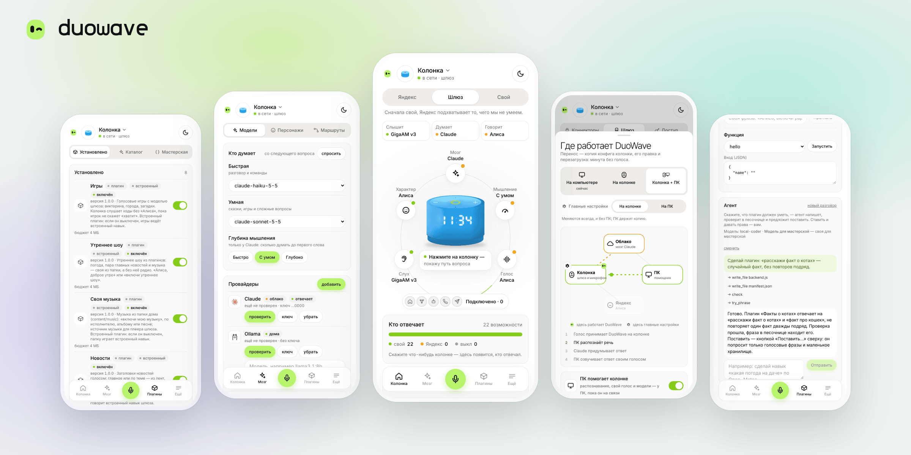
  </picture>
</p>

<h1 align="center">DuoWave</h1>

<p align="center">
  <b>Ваша колонка. Любой ИИ.</b><br>
  Открытый голосовой шлюз для Яндекс Станции: своя модель, свой голос, свои навыки —<br>
  и вы сами решаете, что уходит в облако, что Яндексу, а что остаётся дома.
</p>

<p align="center">
  <a href="https://duowave.app">duowave.app</a> ·
  <a href="#поставить">Поставить</a> ·
  <a href="docs/plugins/AUTHORING.md">Написать плагин</a> ·
  <a href="#чем-рискуете-и-как-вернуть">Как вернуть как было</a>
</p>

<p align="center">
  <a href="https://duowave.app"><picture><source media="(prefers-color-scheme: dark)" srcset="docs/media/duowave-promo-poster-dark.png">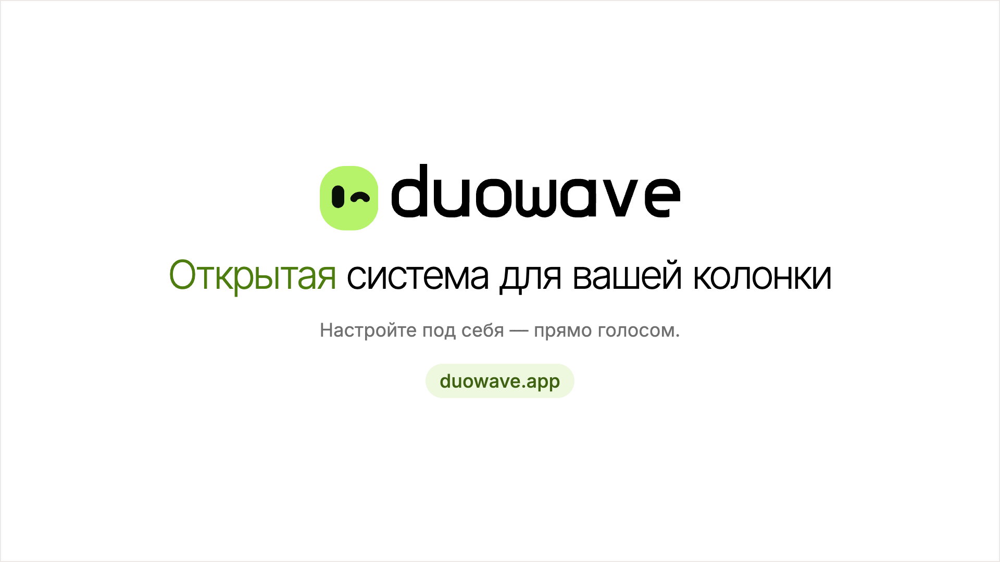</picture></a>
</p>

*A voice gateway for a rooted Yandex Station: any model, your own speech recognition and voice, plugins you write by
voice — and you decide what leaves your home. Runs on the speaker itself, a home server or your computer: Docker,
Linux, macOS, Windows. Open source: Apache-2.0.*

> Проект не связан с Яндексом. Root на колонке — на риск её владельца. «Яндекс», «Алиса» и «Яндекс Станция» —
> товарные знаки их владельцев.

## Что это

Колонка с root говорит не с облаком Яндекса, а с DuoWave. DuoWave — шлюз: на каждый вопрос он решает, кто слушает,
кто думает и кто говорит. Своя модель — в облаке по своему ключу или дома. Своё распознавание и свой голос — дома.
Чего своё не умеет, подхватывает Яндекс: музыка, сказки, умный дом продолжают работать как раньше.

- **Любая модель.** Claude, OpenAI, Gemini, DeepSeek, Mistral, Groq, OpenRouter, YandexGPT — по своему ключу; дома —
  Ollama и LM Studio. Быстрая модель для коротких ответов, умная — для сложных.
- **Вы решаете, что уходит из дома.** У каждой возможности свой маршрут: своё, Яндекс, по очереди или выключено.
  Облачная модель получает текст вопроса, не звук.
- **Навыки голосом.** «Давай сделаем навык» — и колонка сама напишет плагин, проверит его в песочнице и предложит
  поставить. Или то же в мастерской пульта, с агентом.
- **Персонажи.** Характер, тон и голос одним выбором; свои персонажи и персонажи из каталога.
- **Свой голос.** Колонка говорит голосом по записи — например, голосом мамы для сказок на ночь. Или готовыми
  голосами Silero и Piper, или голосом Алисы.
- **Где удобно.** На самой колонке, на домашнем сервере, на компьютере — или колонка вместе с сервером.

## Возможности

### Мозг: любая модель и свои маршруты

<p align="center">
  <picture><source media="(prefers-color-scheme: dark)" srcset="docs/media/panel-brain-dark.png">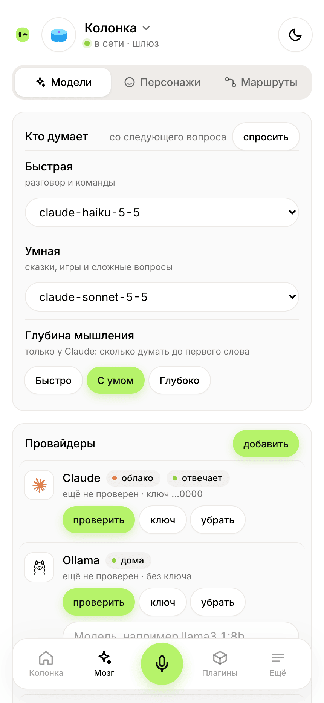</picture>
  <picture><source media="(prefers-color-scheme: dark)" srcset="docs/media/panel-routes-dark.png">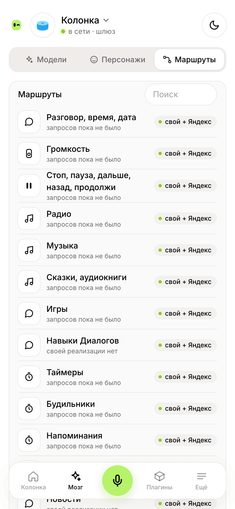</picture>
  <picture><source media="(prefers-color-scheme: dark)" srcset="docs/media/panel-home-dark.png">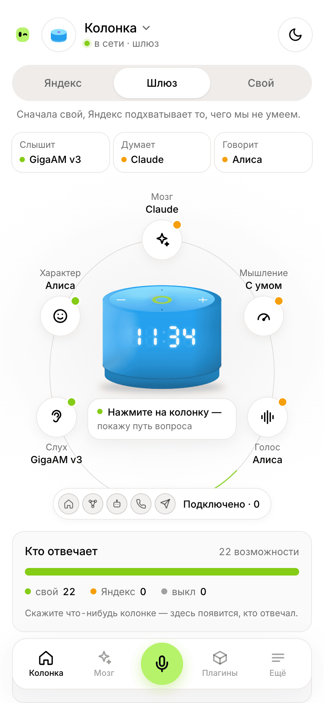</picture>
</p>

Провайдеры — со своим ключом или дома; глубина мышления; MCP-серверы как инструменты модели. У каждой возможности —
погоды, музыки, умного дома, будильников — свой исполнитель. Главный экран показывает, кто сейчас слышит, думает и
говорит.

### Плагины и мастерская: навыки голосом

<p align="center">
  <picture><source media="(prefers-color-scheme: dark)" srcset="docs/media/workshop-dark.gif">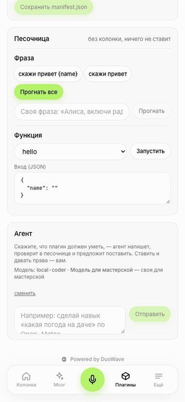</picture>
  <picture><source media="(prefers-color-scheme: dark)" srcset="docs/media/panel-plugins-dark.png">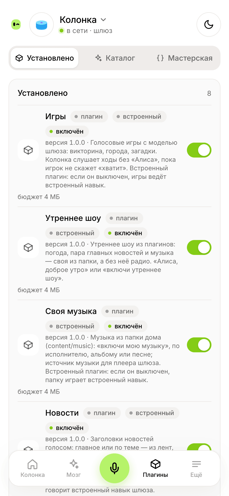</picture>
</p>

- **Плагины** добавляют колонке фразы, инструменты для модели, источники музыки и радио. Код работает в песочнице
  (QuickJS или WebAssembly) с лимитами памяти и времени и получает только те права, что вы дали. Плагин может быть и
  MCP-сервером или отдельным приложением.
- **Мастерская** пишет их за вас: голосом через колонку («Давай сделаем навык»), в пульте с агентом или из
  [Claude Code](https://claude.com/claude-code) — через MCP-сервер мастерской и команду `duowave plugin`. Черновик
  проверяется в песочнице, ставите его вы.
- **Каталог**: плагины, персонажи и темы пульта. Ставится только то, что выберете.

Как написать плагин руками — [docs/plugins/AUTHORING.md](docs/plugins/AUTHORING.md).

### Персонажи и свой голос

<p align="center">
  <picture><source media="(prefers-color-scheme: dark)" srcset="docs/media/panel-characters-dark.png">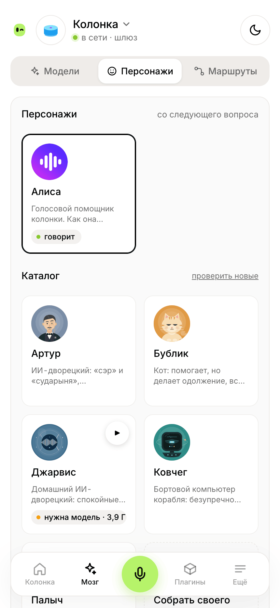</picture>
  <picture><source media="(prefers-color-scheme: dark)" srcset="docs/media/panel-voice-dark.png">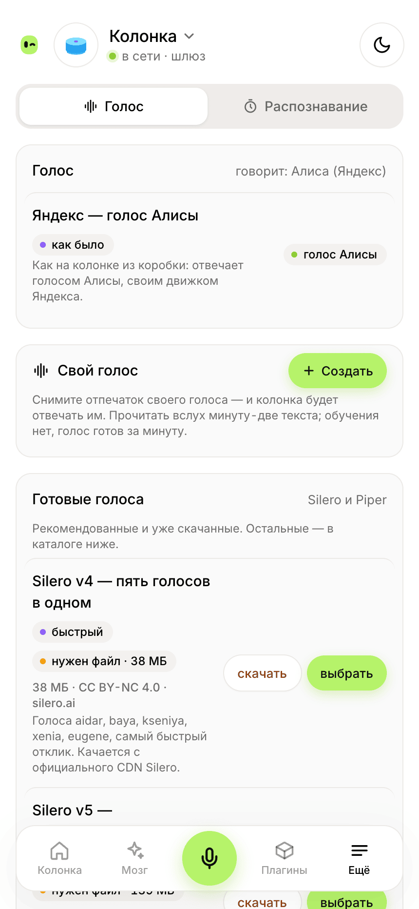</picture>
  <picture><source media="(prefers-color-scheme: dark)" srcset="docs/media/panel-catalog-dark.png">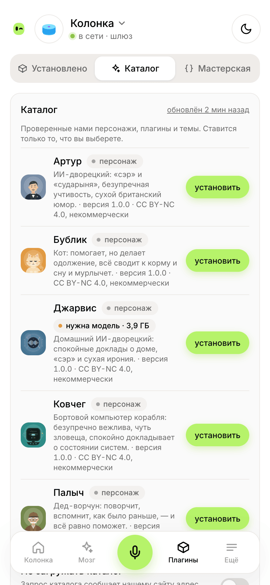</picture>
</p>

Персонаж — характер, тон и голос колонки одним выбором, с регуляторами и полным текстом для тонкой настройки. Свой
голос снимается по записи прямо в пульте (OmniVoice или CosyVoice 3; нужна видеокарта или терпение), готовые голоса —
Silero и Piper. Записи голоса остаются у вас и никуда не уходят.

### Где работает DuoWave

<p align="center">
  <picture><source media="(prefers-color-scheme: dark)" srcset="docs/media/placement-dark.gif">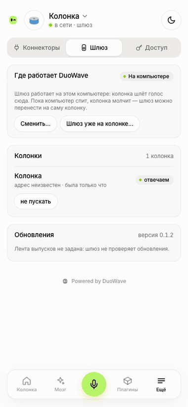</picture>
  <picture><source media="(prefers-color-scheme: dark)" srcset="docs/media/panel-placement-dark.png">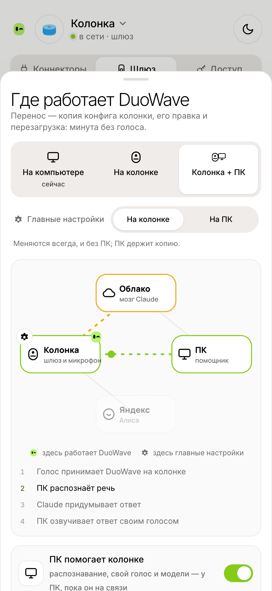</picture>
</p>

- **На колонке** — без компьютера дома: шлюз живёт на самой колонке, модели — облачные.
- **На домашнем сервере или компьютере** — Docker, Home Assistant, Linux, macOS, Windows; тут же своё распознавание,
  голос и модели.
- **Колонка + сервер** — шлюз на колонке, а тяжёлое (распознавание, свой голос, модели) — на сервере дома; сервер
  уснул — колонка переходит на облако и Яндекс и не молчит.

Переезд — кнопкой в пульте, со схемой, кто что делает.

### Из коробки и интеграции

<p align="center">
  <picture><source media="(prefers-color-scheme: dark)" srcset="docs/media/panel-connectors-dark.png">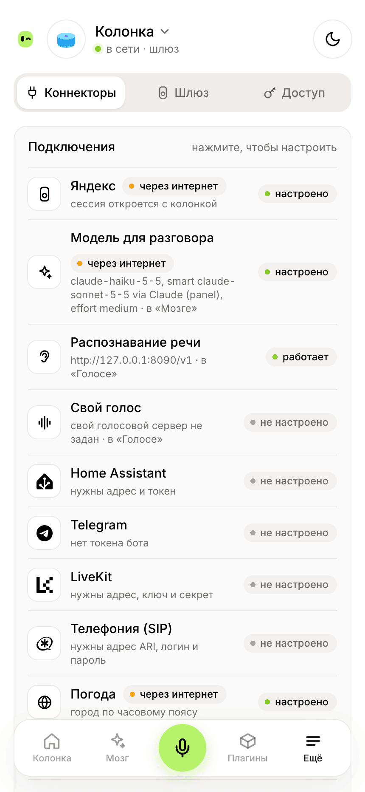</picture>
</p>

- **Навыки:** радио, погода, новости, утреннее шоу, сказки (и сочинённые на ходу), игры, умный дом, будильники,
  своя музыка.
- **Подключения:** Home Assistant, MCP-серверы, Telegram (сообщения и звонки контактам), Claude Code. Свои скрипты
  и агенты (OpenClaw и другие) — через ключ API шлюза; готовые коннекторы к агентам — скоро.

## Чем рискуете и как вернуть

- **Что меняется на колонке:** файл прошивки `/system/vendor/quasar/quasar.cfg` — ничем. Поверх него при каждой
  загрузке подключается (bind-mount) наша копия, в которой другие только два адреса: голосовой сервер
  (`aliced.uniProxyUrl`) и QUIC рядом. Копия и всё остальное наше лежит в `/data/opt/duowave`. На разделе
  прошивки — один скрипт загрузки `/etc/init.d/S95duowave`: без `/data/opt/duowave` он ничего не делает.
- **Вернуть как было** — четырьмя способами:
  1. пульт: имя колонки вверху → «Вернуть к Яндексу»;
  2. голосом, пока шлюз жив: «Алиса, аварийный возврат к Яндексу» — шлюз отвечает раньше любых правил и модели;
  3. без шлюза: `ssh -p 2222 root@<колонка> sh /data/opt/duowave/restore.sh`;
  4. без ничего — одной командой (её же шлюз отдаёт по адресу `/station/restore.sh`):
     `ssh -p 2222 root@<колонка> 'wget -qO- http://<шлюз>/station/restore.sh | sh'`.
- **Сброс кнопками** чистит `/data`, а с ним и нашу копию: после сброса это обычная Алиса.
- **Обновление от Яндекса** меняет файл прошивки: копия, снятая со старого файла, при загрузке не подключается, и
  колонка становится обычной Алисой (пульт скажет, что она обновилась; «Подключить» соберёт копию заново). Но
  обновление может закрыть root — отключите их по вики: шлюз при подключении проверяет и предупреждает.
- **Компьютер со шлюзом выключен — колонка молчит** (если шлюз не на ней самой). Закрепите за ним адрес в роутере
  (резервирование DHCP): шлюз ждёт колонку по одному адресу. Шлюз на самой колонке со страховкой: если он падает или
  перестаёт отвечать, колонка сама возвращается туда, куда шла раньше.

## Что нужно

- **Колонка с root и SSH** по вики сообщества [hackalice](https://hackalice.me/start/): root, SSH (Dropbear на порту
  2222) и отключённые обновления. Шлюз root не делает. Проверено на Яндекс Станции Лайт 2; другая модель с root —
  расскажите, как прошло, в issue «Новая модель колонки».
- **Где запустить шлюз:** на самой колонке, или на компьютере дома, который включён всегда: Linux, Mac, Windows, NAS,
  Raspberry Pi 4/5 с 64-битной системой. Шлюзу хватает до 200 МБ памяти; своё распознавание и голос — ещё 2–4 ГБ, свой
  голос по записи — 3–8 ГБ.
- **Порт 7780** на этом компьютере: на нём пульт, и колонка ходит на него. Занят — подойдёт любой свободный: приложение
  предложит его само, в остальных случаях — строка `PORT` в `.env` (в Docker — `GATEWAY_PORT`).

## Поставить

### Приложение — Windows, macOS, Linux

Установщик — в [последнем выпуске](https://github.com/duowaveai/duowave/releases/latest): `.dmg` для Mac, `.exe` или
`.msi` для Windows, `.AppImage`, `.deb` или `.rpm` для Linux. Шлюз работает в трее, пульт — в своём окне, о новой
версии приложение скажет само. Установщики пока без подписи Apple и Microsoft: система предупредит при первом запуске.

### Docker — Linux, NAS, Raspberry Pi; Windows и Mac через Docker Desktop

```sh
git clone https://github.com/duowaveai/duowave && cd duowave
docker compose up -d --build                    # шлюз и пульт
docker compose --profile full up -d --build     # + своё распознавание и голос на процессоре
```

Пульт: `http://<этот компьютер>:7780/panel` (другой порт — `GATEWAY_PORT=…` в `.env`). Код первой настройки, если пульт открыт не с этого компьютера, — в журнале:
`docker compose logs gateway`. Всё, что шлюз хранит, — в томе `gateway-data`. Наборы, видеокарта NVIDIA, звонки —
в начале [compose.yaml](compose.yaml). Есть и дополнение для Home Assistant — [deploy/home-assistant](deploy/home-assistant).

### Linux без Docker — служба systemd

Программа — архив `duowave-linux-<процессор>.tar.gz` из [последнего выпуска](https://github.com/duowaveai/duowave/releases/latest),
скрипт службы — из этого репозитория:

```sh
git clone https://github.com/duowaveai/duowave && cd duowave
tar -xzf ~/Downloads/duowave-linux-x86_64.tar.gz
DUOWAVE=./duowave deploy/linux/install.sh     # служба, данные в /var/lib/duowave, порт 7780
```

### На самой колонке — пакет YAM

На колонке с менеджером пакетов [YAM 0.2](https://hackalice.me/start/packages/) (пока Станция Лайт 2): файл
`duowave-gateway-<версия>-plum.yampkg` из [последнего выпуска](https://github.com/duowaveai/duowave/releases/latest) — на колонку, и в её консоли

```sh
yam install ./duowave-gateway-<версия>-plum.yampkg
```

Шлюз сразу работает и стартует вместе с колонкой, пульт — `http://<адрес колонки>:8790`. Голос колонки остаётся у
Яндекса, пока вы не направите его в шлюз кнопкой в пульте (или `duowave station point local --reboot`). Обновление —
так же, файлом новой версии; выключить, удалить и всё остальное — в
[station-client/README.md](station-client/README.md#пакет-yam-шлюз-на-самой-колонке).

### Из исходников

Нужны Rust (stable), Node.js 26 и pnpm 11 — Node только чтобы собрать пульт, он входит в программу:

```sh
pnpm install && pnpm --filter panel build
cargo build -p duowave --release        # target/release/duowave
target/release/duowave serve
```

## Первый запуск

1. **Пароль.** Откройте пульт (`http://<этот компьютер>:7780/panel`; приложение откроет его само) и задайте пароль
   администратора.
2. **Колонка.** Пульт сразу откроет «Подключить колонку» — позже его же откроет кнопка на главном экране или имя
   колонки вверху → «Добавить колонку». Шлюз найдёт колонку в сети (или попросит её адрес), с вашего согласия
   прочитает её настройки, ничего не меняя, и построчно покажет, что изменит. По «Подключить» он сохранит копию,
   поменяет два адреса, проверит файл и перезагрузит колонку — около минуты. Если она не придёт за 3 минуты, шлюз
   предложит вернуть всё как было.
3. **Проверка.** Скажите «Алиса, сколько времени?» — вопрос появится на главном экране.

Не хотите пускать шлюз на колонку — «Сделаю сам» даст одну команду:

```sh
ssh -p 2222 root@<колонка> 'wget -qO- http://<шлюз>/station/connect.sh | sh'
```

Сначала колонка работает как раньше, через шлюз: режим «Яндекс». Своё включают по одному: модель — в «Мозге»,
распознавание и голос — в «Голосе», что кому отвечать — в «Мозг» → «Маршруты».

## Что уходит из дома

| Режим | Куда идёт голос | Кто отвечает |
|---|---|---|
| «Яндекс» | к Яндексу, как без шлюза | Яндекс |
| «Шлюз» | распознаёт своё или Яндекс — как выбрано | своя модель, а чего она не умеет — Яндекс |
| «Свой» | никуда: распознавание и голос дома | только своё; модель — облачная или дома, как выбрано |

Облачная модель получает текст вопроса, не звук. Звук запросов шлюз на диск не пишет, пока это не включить для
отладки. Журнал хранится 7 дней.

## Обновления

Шлюз сам узнаёт о новой версии и показывает её в пульте; ставит — только по кнопке. Каждый выпуск подписан, шлюз
проверяет подпись перед установкой. Приложение обновляется так же; Docker — `git pull && docker compose up -d --build`; пакет на колонке —
`yam install` файла новой версии из выпуска.

## Разработчикам

- Как устроен шлюз — [docs/ARCHITECTURE.md](docs/ARCHITECTURE.md), программа — [gateway/](gateway/), пульт —
  [panel/](panel/), приложение — [desktop/](desktop/).
- Плагины, приложения, персонажи и темы — [docs/plugins/AUTHORING.md](docs/plugins/AUTHORING.md).
- Как предложить изменения — [CONTRIBUTING.md](CONTRIBUTING.md).

## Лицензия

- **Код** — [Apache-2.0](LICENSE): пользоваться, менять, раздавать и продавать может любой. Домашняя установка —
  полная: ничего в ней не запирается и не проверяет подписку.
- **Документация** — [CC BY 4.0](docs/LICENSE).
- **Чужие библиотеки и модели** — со своими лицензиями: [THIRD_PARTY.md](THIRD_PARTY.md). Некоторые модели (Silero,
  OmniVoice) — только некоммерческие.
- **Имя DuoWave и знак ДиВи** — товарные знаки, лицензия кода их не покрывает: [TRADEMARKS.md](TRADEMARKS.md).
- **Вклады** — под теми же лицензиями, без отдельного соглашения: [CONTRIBUTING.md](CONTRIBUTING.md).

## Сообщество

Вики и чат по колонкам — [hackalice.me](https://hackalice.me) и [@hackalice](https://t.me/hackalice). Ошибки и новые
модели колонок — в [issues](https://github.com/duowaveai/duowave/issues). Уязвимости — по [SECURITY.md](SECURITY.md), не
в issues.
