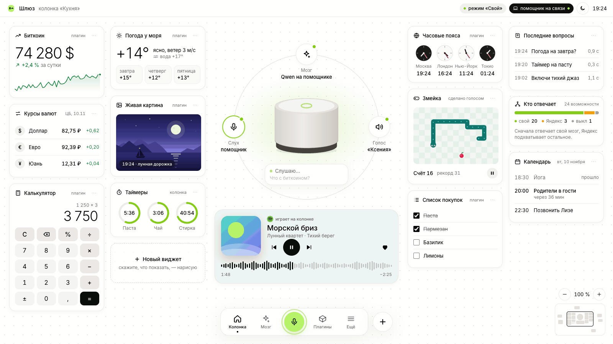
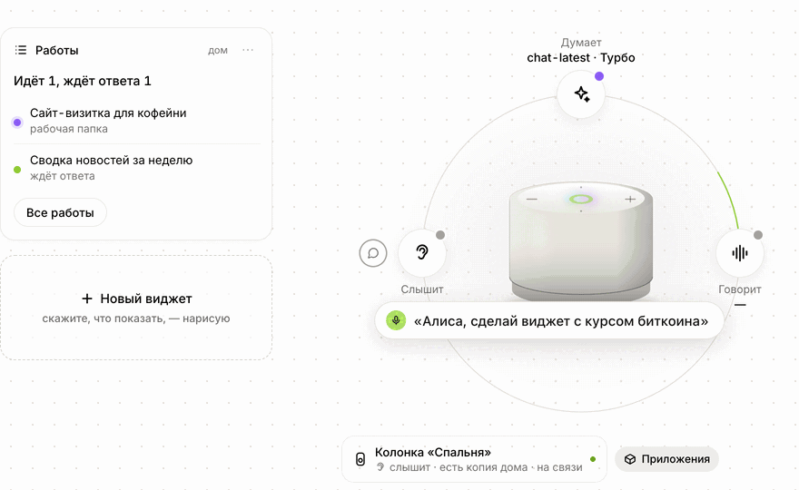
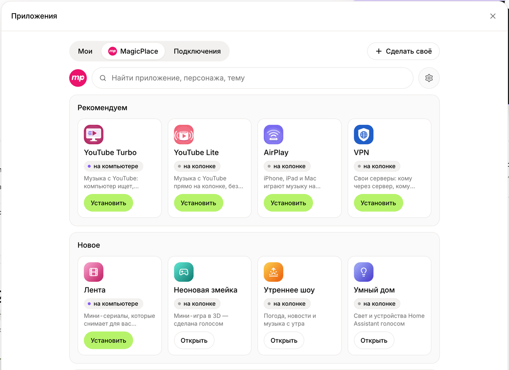

<p align="center">
  <a href="https://duowave.ai"><picture>
    <source media="(prefers-color-scheme: dark)" srcset="docs/media/desk-dark.gif">
    
  </picture></a>
</p>

<h1 align="center">DuoWave</h1>

<p align="center">
  Открытый голосовой помощник для Яндекс Станции и компьютера. Отвечает любая модель, голос можно выбрать или
  записать свой, а приложения и виджеты собираются по просьбе голосом.
</p>

<p align="center">
  An open-source voice assistant for a rooted Yandex Station and your computer: any AI model, your own voice, apps
  built by voice. Apache-2.0.
</p>

<p align="center">
  <a href="https://duowave.ai">duowave.ai</a> ·
  <a href="#поставить">Поставить</a> ·
  <a href="#как-вернуть-как-было">Как вернуть как было</a> ·
  <a href="docs/plugins/AUTHORING.md">Написать приложение</a> ·
  <a href="https://t.me/+NhXi1k_GYH00YWE1">Telegram</a>
</p>

> Проект не связан с Яндексом. Root на колонке делается по вики сообщества hackalice, на риск владельца колонки.
> «Яндекс», «Алиса» и «Яндекс Станция» — товарные знаки их владельцев.

## Что умеет

- **Любая модель.** Claude, ChatGPT, Gemini, DeepSeek, YandexGPT и другие: по своему ключу, через OpenRouter или по
  подписке ChatGPT. Можно и модель у себя дома: Ollama, LM Studio.
- **Алиса остаётся.** Чего DuoWave не умеет, делает Алиса: музыка, сказки и умный дом работают как раньше. Кто
  отвечает, выбирается одной кнопкой: «Алиса», «Алиса + ваш ИИ» или «Ваш ИИ».
- **Свой голос и персонажи.** Голос записывается прямо в пульте, хватит минуты чтения вслух. У персонажа свой
  характер, голос и слово для вызова.
- **Приложения голосом.** Скажите «Алиса, сделай виджет с курсом биткоина», и он появится на столе. Готовые
  приложения ставятся одной кнопкой из магазина MagicPlace: AirPlay, YouTube, VPN, персонажи, темы.
- **Колонка и компьютер вместе.** DuoWave живёт на колонке. Компьютер, пока включён, берёт тяжёлое: распознаёт речь,
  говорит вашим голосом, запускает модели. Выключили его, и колонка отвечает через облако.
- **Вы решаете, что уходит из дома.** Облачная модель получает только текст вопроса, не звук. Можно держать всё дома.

<p align="center">
  <picture><source media="(prefers-color-scheme: dark)" srcset="docs/media/voice-widget-dark.gif"></picture>
</p>

<p align="center">
  <picture><source media="(prefers-color-scheme: dark)" srcset="docs/media/magicplace-dark.png"></picture>
</p>

## Поставить

Нужна Яндекс Станция с root и SSH. Как их получить, написано в [вики hackalice](https://hackalice.me/start/).
DuoWave root не делает. Мы проверяем всё на Станции Лайт 2. Если у вас другая модель, расскажите в
[issues](https://github.com/duowaveai/duowave/issues), как прошло.

### На колонку одной командой

Выполните на любом компьютере в той же сети Wi-Fi. macOS и Linux, в Терминале:

```sh
curl -fsSL https://github.com/duowaveai/duowave/releases/latest/download/install.sh | sh
```

Windows, в PowerShell:

```powershell
irm https://github.com/duowaveai/duowave/releases/latest/download/install.ps1 | iex
```

Команда найдёт колонку, покажет, что изменит, и после вашего «да» поставит DuoWave. В конце она покажет адрес пульта
и код первой настройки. Компьютер после этого можно выключить.

### Приложение для компьютера

Установщики для macOS, Windows и Linux лежат в
[последнем выпуске](https://github.com/duowaveai/duowave/releases/latest). При первом запуске выберите, где живёт
DuoWave: на колонке, на компьютере или на обоих. Установщики пока без подписи, поэтому система предупредит при первом
запуске.

Самому DuoWave хватает 200 МБ ОЗУ. Распознавание речи и голос на компьютере просят ещё 2–4 ГБ, свой голос по записи
3–8 ГБ.

### Другие способы

- **Docker** (домашний сервер, NAS, Raspberry Pi): `git clone https://github.com/duowaveai/duowave && cd duowave &&
  docker compose up -d`. Пульт откроется на порту 7780, настройки в начале [compose.yaml](compose.yaml).
- **Пакет YAM** прямо на колонке: [station-client/README.md](station-client/README.md#пакет-yam-шлюз-на-самой-колонке).
- **Служба Linux** без Docker: [deploy/linux](deploy/linux).
- **Из исходников:** Rust, Node.js 26 и pnpm 11.

  ```sh
  pnpm install && pnpm --filter panel build
  cargo build -p duowave --release
  target/release/duowave serve
  ```

## Как вернуть как было

DuoWave не трогает файлы прошивки. Поверх настроек колонки он подключает свою копию, в которой изменены только два
адреса. Всё своё он хранит в `/data/opt/duowave`.

- **Вернуть ответы Алисе:** в пульте «Кто отвечает» → «Алиса» или голосом «Алиса, аварийный возврат к Яндексу».
- **Без пульта:** `ssh -p 2222 root@<колонка> sh /data/opt/duowave/restore.sh`.
- **Удалить DuoWave совсем:** `ssh -p 2222 root@<колонка> sh /data/opt/duowave/uninstall.sh`.
- **Сброс колонки кнопками** тоже возвращает обычную Алису.

Если DuoWave на колонке упадёт, она сама вернётся к Яндексу. Обновление от Яндекса может закрыть root, поэтому
отключите обновления по вики.

## Обновления

О новой версии пульт скажет сам, ставится она одной кнопкой. Каждый выпуск подписан, и DuoWave проверяет подпись
перед установкой. В Docker: `docker compose pull && docker compose up -d`.

## Разработчикам

- Как всё устроено: [docs/ARCHITECTURE.md](docs/ARCHITECTURE.md).
- Приложения, персонажи и темы: [docs/plugins/AUTHORING.md](docs/plugins/AUTHORING.md).
- Как предложить изменения: [CONTRIBUTING.md](CONTRIBUTING.md).

## Лицензия

Код под [Apache-2.0](LICENSE), документация под [CC BY 4.0](docs/LICENSE). Домашняя версия полная и бесплатная.
У чужих библиотек и моделей свои лицензии, некоторые только некоммерческие: [THIRD_PARTY.md](THIRD_PARTY.md). Имя
DuoWave и его знак лицензия кода не покрывает: [TRADEMARKS.md](TRADEMARKS.md).

## Сообщество

- Новости: канал [@DuoWaveAi](https://t.me/+NhXi1k_GYH00YWE1).
- Вопросы и разговоры: [чат](https://t.me/+3HQjqPeBP0xkZThl).
- Вики и чат по колонкам: [hackalice.me](https://hackalice.me) и [@hackalice](https://t.me/hackalice).
- Ошибки и новые модели колонок: [issues](https://github.com/duowaveai/duowave/issues). Уязвимости присылайте по
  [SECURITY.md](SECURITY.md), не в issues.

<sub>DuoWave в Telegram: [t.me/DuoWaveAi](https://t.me/DuoWaveAi)</sub>
